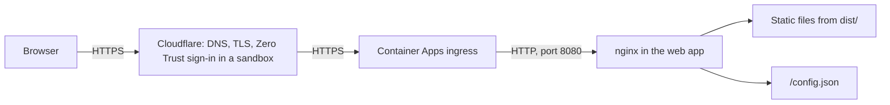

# Architecture

The site is one image that runs as one app. Astro turns the pages and the Markdown content into plain HTML, CSS and JavaScript at build time, and nginx serves those files. There is no server code, no API and no database.

## 1. Image and app

| Part | What it is |
| --- | --- |
| Image `web` | Built from `Dockerfile` in two stages. The first stage runs `pnpm build` on Node 22 and writes `dist/`. The second is the unprivileged nginx image, which copies `dist/` and serves it on port 8080 as the user `nginx`, never as root. The image also leaves out what the site never uses, curl and nginx's unused modules, so it has less to scan and patch |
| App `web` | The container app in the stamp that runs the image, named in `platform.yaml`. It scales to zero replicas when nobody visits, and up to two |

`platform.yaml` lists both. The platform builds the image once per commit on `main` and runs the same image in every Environment.

## 2. Request path

1. The browser asks for the site's hostname. Cloudflare answers, ends TLS, and in a sandbox asks the visitor to sign in first.
2. Cloudflare passes the request to the stamp's Container Apps environment, which sends it to the `web` app on port 8080.
3. nginx answers from the files in `dist/`, or with `/config.json`, `/healthz` or `/readyz`.

## 3. What nginx does

`nginx/default.conf` holds all of it:

| Concern | Rule |
| --- | --- |
| Routing | `/about` serves `about/index.html`. A path with no file serves `404.html` with status 404 |
| Caching | Files under `/_astro/` have a hash in their name and are cached for a year. Every other file is checked again on each visit. `/config.json` is never cached |
| Security headers | `Content-Security-Policy` (scripts, styles and images only from the site itself), `Strict-Transport-Security`, `X-Content-Type-Options`, `X-Frame-Options`, `Referrer-Policy` and `Permissions-Policy` on every answer |
| Health | `/healthz` (liveness) and `/readyz` (readiness) both answer `ok`: nginx serves the files itself, so it is ready as soon as it runs |

Astro writes styles and scripts to files, never inline (`astro.config.mjs`), so the Content-Security-Policy needs no `'unsafe-inline'`. If you add a third-party script, font or image, add its origin to the policy.

## 4. Environment values

The image holds nothing that differs between Environments. When the container starts, `docker-entrypoint.d/40-config.sh` writes `/config.json` from the container's settings, and the browser reads it through `src/lib/config.ts`. The details are in [configuration.md](configuration.md).

## 5. Where things live

| Folder or file | Holds |
| --- | --- |
| `src/pages/` | One file per page. The file's path is the URL |
| `src/layouts/BaseLayout.astro` | The head, header and footer every page shares, and the global styles |
| `src/components/` | Reusable parts of pages |
| `src/content/articles/` | Markdown articles, described in `src/content.config.ts` |
| `src/lib/config.ts` | The one place that reads `/config.json` |
| `public/` | Files copied as they are: the favicon and `robots.txt` |
