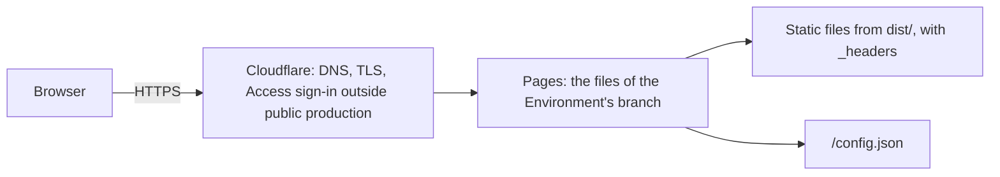

# Architecture

The site is plain files. Astro turns the pages and the Markdown content into HTML, CSS and JavaScript at build time, and Cloudflare Pages serves those files. There is no server code, no API and no database.

## 1. Build and hosting

| Part | What it is |
| --- | --- |
| The build | `pnpm build` runs Astro on Node 22 and writes `dist/`: one HTML file per page and language, the styles, scripts and fonts under `/_astro/`, the sitemap, `robots.txt`, `security.txt` and `_headers` |
| Cloudflare Pages | The project `<repository>` serves `dist/` from Cloudflare's edge. There is no server, container or process of the site's own to run, scale or patch |

A release is built once, by *Release new version*, and the same files go to staging and production. Only `/config.json` is written per Environment, at deploy (and in production the environment badge is taken out of the pages) ([deployment.md](deployment.md)).

## 2. Request path

1. The browser asks for the site's hostname. Cloudflare answers, ends TLS, and outside public production asks the visitor to sign in with Access first.
2. The hostname leads to the Pages project: production's hostnames are custom domains of the project, and dev's and staging's are CNAMEs to the `dev` and `staging` branches.
3. Pages answers from the files of that branch's newest deployment, with the headers in `_headers`.

## 3. What Pages does

| Concern | Rule |
| --- | --- |
| Routing | `/en/about` serves `en/about.html` and `/en` serves `en.html` (`build.format: "file"` in `astro.config.mjs`). An address ending in `/` or `.html` is redirected (308) to the one without. `/` is a small page that leads to the default language. A site's own redirects (an earlier site's addresses) go in `public/_redirects`; the build keeps them after the 301 from `/`. A path with no file serves `404.html` with status 404 |
| Caching | Files under `/_astro/` have a hash in their name and are cached for a year. Every other file is checked again on each visit. `/config.json` is never cached |
| Security headers | `Content-Security-Policy` (scripts, styles and images only from the site itself), `Strict-Transport-Security`, `X-Content-Type-Options`, `X-Frame-Options`, `Referrer-Policy` and `Permissions-Policy` on every answer, and no `Access-Control-Allow-Origin` |

`public/_headers` holds the headers and caching; `scripts/write-config.mjs` is not changed at deploy. Two rules in `_headers` with the same path don't add up (only the last counts), so keep one rule `/*`. Astro writes styles and scripts to files, never inline (`astro.config.mjs`), so the Content-Security-Policy needs no `'unsafe-inline'`. If you add a third-party script, font or image, add its origin to the policy.

Check routing and headers locally with `wrangler pages dev` ([getting-started.md](getting-started.md)).

## 4. Environment values

The build holds nothing that differs between Environments. Each deploy writes `/config.json` into the files from the Environment's settings, and the browser reads it through `src/lib/config.ts`. The details are in [configuration.md](configuration.md).

## 5. Where things live

| Folder or file | Holds |
| --- | --- |
| `src/site.config.ts` | The site's facts, built into the pages: languages, company, contact, legal pages, structured data, `security.txt` ([site-settings.md](site-settings.md)) |
| `src/pages/[...lang]/` | One file per page, built once per language. The file's path is the URL after the language |
| `src/pages/` | The 404 page, `robots.txt` and `.well-known/security.txt` |
| `src/layouts/BaseLayout.astro` | The head, header and footer every page shares |
| `src/styles/` | `global.css`, the layout and components, and `tokens.css`, the brand's colours and font |
| `src/components/` | Reusable parts of pages |
| `src/content/<collection>/<language>/` | Markdown items of the lists in `collections` of `src/site.config.ts`, described in `src/content.config.ts` |
| `src/content/legal/<language>/` | The privacy policy, the accessibility statement and the sustainability page |
| `src/i18n/` | The interface strings per language, and the helpers for language URLs |
| `src/lib/config.ts` | The one place that reads `/config.json` |
| `public/` | Files copied as they are: the favicon (with `src/components/Logo.astro`, the brand's logo) and `_headers` |
| `scripts/` | The page-weight and `security.txt` checks that `pnpm test` runs on `dist/`, the deploy-time settings (`write-config.mjs`), the release versions (`version.mjs`), `pnpm status`, their unit tests, and the yearly CO₂ estimate (`pnpm co2`) |
| `.github/workflows/` | ci, and the deploy, release and promote workflows ([deployment.md](deployment.md)) |
