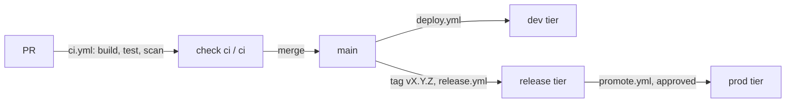

# Deployment

The platform builds the image once for each commit on `main`, and moves that same image, by its digest, from Environment to Environment. Nothing is rebuilt for production. You never deploy by hand and never create infrastructure yourself.

## 1. Environments and tiers

Each Environment of the repository is one stamp: a Container Apps environment with the `web` app, in Azure. Each belongs to a tier:

| Tier | Environments | Gets |
| --- | --- | --- |
| `dev` | `dev`, `<customer>-dev` | Every push to `main` |
| `release` | `test`, `staging`, `uat`, `perf`, `demo`, and their `<customer>-` forms | Every release tag `vX.Y.Z` |
| `prod` | `prod`, `<customer>-prod` | Only a promotion, after the Environment's reviewers approve |

A new repository starts with `dev`. Your team asks for another Environment through the platform team's onboarding form.

## 2. From PR to production



| Step | Workflow | What happens |
| --- | --- | --- |
| Check | `ci.yml`, on every PR and push to `main` | Builds the image, runs `pnpm test`, scans the image with Trivy and checks `platform.yaml`. Pushes nothing. The check `ci / ci` must pass before a PR can merge |
| Deploy | `deploy.yml`, on every push to `main` | Builds the image once, scans it, pushes it to the GitHub Container Registry (GHCR) as `sha-<commit>` with its software bill of materials, and deploys it to every `dev` tier Environment |
| Release | `release.yml`, on a tag `vX.Y.Z` on a commit of `main` | Builds nothing. Adds the tag to that commit's image, creates the GitHub Release, and deploys it to every `release` tier Environment |
| Promote | `promote.yml`, by hand with a version and an Environment | Checks that the version runs healthy in a `release` tier Environment, waits for the reviewers, and deploys the same image. Rolling back is promoting the previous version |

This template has only `ci.yml`. The platform team adds `deploy.yml` and `release.yml` next, and `promote.yml` before the first production Environment. In a template repository, `deploy.yml` and `release.yml` skip every job, because a template deploys nowhere. In a repository created from the template they run as above.

Each workflow is a thin caller of a reusable workflow in `tl-platform`, pinned to a tag `app-workflows/v<x.y.z>`. Don't add steps to them: the platform team changes the reusable workflows, and a PR bumps the tag in your repository.

A deploy starts a new revision of the app. The revision gets traffic only once `/readyz` answers, and the previous one keeps serving until then. A deploy that fails leaves the Environment on the version it had.

## 3. Images

Images are stored in GHCR as `ghcr.io/trislabcompany/<repository>/web`. They are private, also when the repository is public. The stamps pull them with the platform's pull token. You don't need to do anything for this.

Trivy scans the image in every workflow. It fails on any secret in the image, and on a CRITICAL or HIGH vulnerability that has a fix. To accept a finding, add its ID to `.trivyignore` with a reason and an expiry date on the line above it; `devops` reviews that change.

## 4. `platform.yaml` and the caps

`platform.yaml` says which image the repository builds and how the app is sized:

| Field | Here | Meaning |
| --- | --- | --- |
| `profile` | `Consumption` | Serverless: you pay per use, and the app can scale to zero |
| `cpu` | `0.25` | vCPU per replica, in steps of 0.25 |
| `memory` | `0.5Gi` | Memory per replica. On `Consumption` it must be twice the CPU in Gi |
| `min_replicas` | `0` | No replica while nobody visits; the first visit starts one |
| `max_replicas` | `2` | At most two replicas under load |

Each stamp has caps: the most each app may use. A sandbox stamp's default caps are `Consumption` only, 0.5 vCPU, `1Gi` and at most two replicas, and this file stays within them. `ci / ci` checks `platform.yaml` against the caps of every Environment on each PR in a repository created from the template, so a PR above a cap never merges. Each deploy checks again.

To size one Environment differently, add an override under `environments`, within that Environment's caps:

```yaml
environments:
  prod:
    web: { min_replicas: 1, max_replicas: 4 }
```

## 5. Asking for more

Raising a cap, adding an Environment, a setting or a custom domain is a change to the stamp, not to this repository. Each Environment is a stamp in `tl-cloud-infrastructure`, under `stamps/<landing zone>/<folder>/stamp.yaml`.

| You need | Change in `stamp.yaml` |
| --- | --- |
| More CPU, memory or replicas | `apps[].caps` of `web` |
| A `PUBLIC_` setting | `apps[].env` of `web` ([configuration.md](configuration.md)) |

Your team may open these PRs: the stamp's folder lists your team as a code owner next to the platform team. The infrastructure pipeline plans the change, the platform team approves the apply, and the next deploy can use the new caps. For an Environment or a custom domain, ask the platform team.
