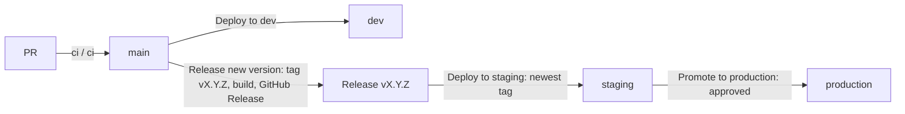

# Deployment

The site is plain files on Cloudflare Pages. Every merge to `main` goes to **dev**. A release is a tag `vX.Y.Z` that is built once and deployed to **staging**, and after it has been checked there, the same files are promoted to **production**. Four workflows do all of it; nobody deploys by hand.

## Environments

One Cloudflare Pages project, `<repository>`, has one Pages branch per Environment. Each Environment is also a GitHub Environment of this repository, which holds its settings and records every deploy.

| Environment | Pages branch | Address | Runs | Gets a new version |
| --- | --- | --- | --- | --- |
| `dev` | `dev` (preview) | the dev address | The newest commit of `main` | On every merge, by *Deploy to dev* |
| `staging` | `staging` (preview) | the staging address | The newest tag `vX.Y.Z` | After every release, by *Deploy to staging* |
| `production` | `production` (the project's production branch) | the production address, later the site's own domain | The tag staging ran when it was promoted | Only by *Promote to production*, after a reviewer approves |

dev, staging and, until the site is public, production ask visitors to sign in with Cloudflare Access. The same files are also reachable at `<branch>.<repository>.pages.dev`, which Access protects too.

## From PR to production



| Workflow | File | Starts | What it does |
| --- | --- | --- | --- |
| ci | `ci.yml` (steps in `checks.yml`) | Every commit of a PR, and every push to `main` | `pnpm test`, accessibility (pa11y-ci) and Lighthouse CI. The check `ci / ci` must pass before a PR merges. Deploys nothing |
| Deploy to dev | `deploy-dev.yml` | Every push to `main`; by hand to deploy the newest commit again | Builds the commit and deploys it to `dev` |
| Release new version | `release.yml` | By hand, from `main`, with `patch`, `minor` or `major` | Picks the next version, writes the notes from the commit messages since the previous version, runs `pnpm test`, builds the site once, pushes an annotated tag `vX.Y.Z` on the newest commit of `main`, and creates the GitHub Release with the notes and the built site, `site-vX.Y.Z.zip` |
| Deploy to staging | `deploy-staging.yml` | When *Release new version* succeeds; by hand | Deploys the newest tag, by semantic version, to `staging`, from its `site-vX.Y.Z.zip`, and records the tag as staging's deployment |
| Promote to production | `promote.yml` | By hand, no input | Reads the tag staging runs, waits for a reviewer of `production`, and deploys the same `site-vX.Y.Z.zip` there |

`pages-deploy.yml` is the one deploy job the last three call. It writes the Environment's `/config.json` into the files, and in production takes the environment badge out of the pages (`scripts/write-config.mjs`, [configuration.md](configuration.md)), deploys them with `wrangler pages deploy`, and records the deploy as a GitHub deployment of the Environment.

Only the build for dev is made from the commit at deploy time. staging and production deploy the files the release built, so production gets exactly what was checked on staging; only `/config.json` differs, and in production the environment badge is gone.

## Versions and release notes

- Versions follow semantic versioning, `vX.Y.Z`: `major` for a change that breaks something for visitors or links, `minor` for a feature, `patch` for a fix. Under `0.x`, a breaking change is a `minor`.
- The next version is the highest existing tag, raised by the part you choose (`scripts/version.mjs`). Tags that are not exactly `vX.Y.Z`, such as old `-rc.N` tags, are ignored.
- The notes are one line per commit since the previous tag: its subject and short SHA. A squash merge's subject is the PR title, so a good PR title is a good release note. The same text is the tag's message.
- A tag is annotated, made by the workflow as `github-actions[bot]`, and never moved or deleted. A ruleset forbids it. A wrong release is replaced by the next version.
- Only people with write access to the repository can run *Release new version* and *Promote to production*. *Release new version* runs only from `main` and refuses when there is no new commit.

## Where the staging version is kept

Every deploy is a GitHub deployment of its Environment, made by `pages-deploy.yml` with the task `deploy:pages` and the version as its ref: a commit for dev, a tag for staging and production. *Promote to production* reads the newest `deploy:pages` deployment of `staging`, checks that it succeeded and that its ref is a tag `vX.Y.Z`, and promotes that tag. GitHub's own deployments for the jobs (task `deploy`) are ignored.

See them with `pnpm status`, under **Deployments** on the repository page, or:

```bash
gh api "repos/{owner}/{repo}/deployments?environment=staging&task=deploy:pages&per_page=5" --jq '.[] | [.ref, .created_at] | @tsv'
```

## Steps

### Ship a change to dev

1. Branch from `main`, commit, run `pnpm test` and `pnpm test:a11y`, and open a PR.
2. `ci / ci` passes, a code owner approves, and you squash-merge.
3. *Deploy to dev* runs on the merge: `gh run watch $(gh run list --workflow deploy-dev.yml --limit 1 --json databaseId --jq '.[0].databaseId')`.
4. Check the change on the dev address.

### Release to staging

1. Check dev: it runs the newest commit of `main`, which is what will be released.
2. Run *Release new version* in the Actions tab, or `gh workflow run release.yml -f bump=patch` (or `minor`, `major`).
3. When it succeeds, *Deploy to staging* starts by itself. Watch it: `gh run list --workflow deploy-staging.yml --limit 1`.
4. Check the release on the staging address. Whoever accepts the content does it here.

### Promote to production

1. `pnpm status` shows the version staging runs. That is the version that will be promoted.
2. Run *Promote to production* in the Actions tab, or `gh workflow run promote.yml`.
3. A reviewer of the `production` Environment approves the waiting job on GitHub. Nobody approves their own run.
4. Check production.

### Roll back

- **production:** in the Cloudflare dashboard, the project's **Deployments**, roll back to the previous production deployment. It takes effect at once and rebuilds nothing. Then fix forward: merge the fix, release, and promote again.
- **dev and staging:** fix forward. Revert the change on `main` through a PR; release again if staging needs it.

### When a run fails

| Failure | Cause and fix |
| --- | --- |
| `ci / ci` | Read `gh run view <run id> --log-failed`; fix and push |
| *Release new version*: "the tag exists already" or "nothing to release" | Someone released at the same time, or there is no commit since the last tag |
| *Deploy to staging*: "has no site-vX.Y.Z.zip" | The newest tag was not made by *Release new version*; release a new version |
| *Promote to production*: "did not succeed" | The newest staging deploy failed; run *Deploy to staging* again first |
| "the Environment … has no variable …", or a Cloudflare authentication error | The Environment is not set up; ask the platform team ([Set up and tear down](#set-up-and-tear-down)) |

A failed deploy leaves the Environment on the version it had: Pages switches only when an upload is complete.

## Set up and tear down

The Pages project, the hostnames, DNS, Access, the GitHub Environments and their settings are declared in `tl-cloud-infrastructure`, so they are created, changed and removed by a reviewed PR there, never by hand.

| Part | Where | Holds |
| --- | --- | --- |
| Pages project `<repository>` | Cloudflare | Direct Upload, production branch `production`, custom domain: the production address |
| DNS | The site's zone | The dev and staging addresses as proxied CNAMEs to `dev.<repository>.pages.dev` and `staging.<repository>.pages.dev` |
| Access | Cloudflare Zero Trust | An application per hostname above, and Pages' access policy for previews and the `pages.dev` addresses |
| GitHub Environments `dev`, `staging`, `production` | This repository | Variables `CLOUDFLARE_ACCOUNT_ID`, `PAGES_PROJECT`, `SITE_URL` and any `PUBLIC_*`, and secret `CLOUDFLARE_API_TOKEN`; `production` has required reviewers and prevents self-review |
| Tag ruleset `v*` | This repository | No update, no deletion |

The token may only edit Pages (`Cloudflare Pages: Edit`); it has no DNS or zone rights. Cloudflare cannot limit it to one project, so it is kept only in the Environments, and production deploys need a reviewer.

**Making the site public:** add the site's domain (and the `www` redirect) to the Pages project, set `SITE_URL` to the site's address on the `production` Environment, remove the Access application of production, and turn the production address into a permanent redirect to the site's domain. `url` in `src/site.config.ts` must already be the site's address, so no rebuild is needed. Nothing else switches indexing on: `dev` and `staging` are protected by Cloudflare Access, which the infrastructure enforces, and `robots.txt` and the sitemap are the same in every Environment.

**Tearing it down:** a PR in `tl-cloud-infrastructure` removes the site's entries. Its apply deletes the custom domains, DNS records, Access applications, the Pages project with all its deployments, the GitHub Environments with their variables and secret, and revokes the token. The repository is archived, not deleted, so its name is never reused. To retire one Environment, remove only its entries.
